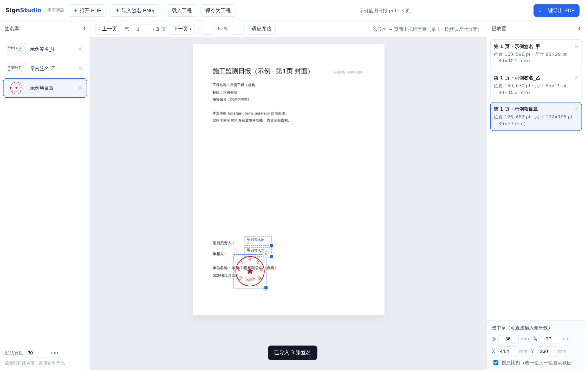
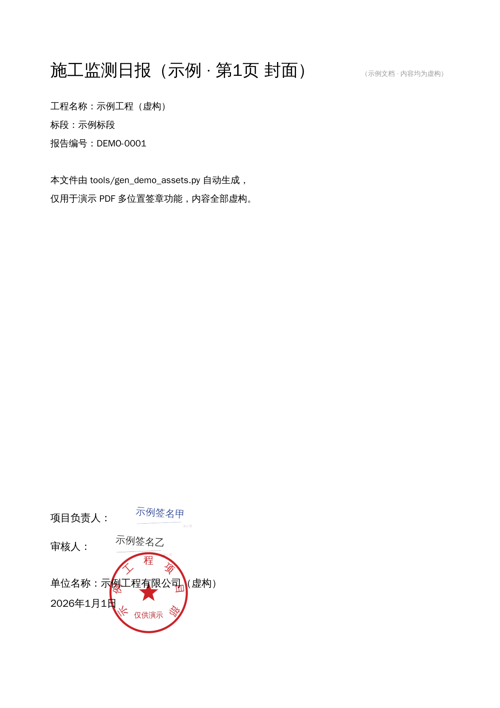

# PDF 多位置签章工具（SignStudio）

给固定版式的 PDF（日报、报表、合同附件等）一次性盖多个电子签章：**每处位置、每张章图、每个尺寸都可以不同**，不用像 WPS 那样一处一处手工点。

原本的痛点是：WPS 的「证书签名」一次只能签一个位置，一份日报要签 9 处就得点 9 遍，每处内容还不一样。本工具把这些位置提前标定好，之后每天拿到新 PDF 一键出结果。

> ⚠️ 本仓库所有的签名图、图章、示例 PDF、公司名、人名**全部是程序生成的虚构素材**（`tools/gen_demo_assets.py`），仅用于演示。





---

## 功能

- **多位置、多章图**：一份配置里可以有几十处签章，跨页、每处独立指定图片、位置、尺寸
- **红章压住文字/签字也不糊**：公章用「正片叠底烘焙」，压在手写签名上时签名笔画仍然清楚（实测笔画保留率 100%）
- **顺序自动保障**：手写签名先贴、红章后贴；即使配置里写反了也会自动纠正，不会被盖成一片红
- **毫米级手动输入**：界面上选中任意一枚章，直接输入宽 / 高 / X / Y 的毫米数；改一边另一边按原图比例自动跟随
- **从已签好的 PDF 学位置**：`--learn` 解析别人手工签好的文件，自动反推出每枚章的实际位置与尺寸
- **零安装网页版**：纯前端（pdf.js + pdf-lib），解压双击 HTML 就能用，不需要装 Python
- **批量盖章**：一次导入多份 PDF，在一份上摆好章，其余文件按同一套位置自动盖章；页尺寸不同自动等比换算，页数不足只跳过该处并计数
- **局域网共享**（v1.5+）：工具跑在一台电脑上，同一 WiFi/网线的其他电脑用浏览器打开即可用；签名库与工程都存主机磁盘并共享，其他电脑不留副本
- **工程模板**：把「每处位置 + 对应章图」存成工程，换新 PDF 一键套用；工程里自带签名副本，拷给别人也能直接用
- **自动更新**：客户端启动时检查更新清单（清单带 Ed25519 签名 + 包 sha256 校验），一键下载覆盖并同端口重启
- **可选数字证书签名**：需要法律效力的场景可传入 `.pfx/.p12`，做标准 PDF 数字签名（多次增量签名），`--verify` 可校验

## 两种用法

| | 零安装网页版 | Python 命令行 / 本地服务 |
|---|---|---|
| 需要装 Python | 不需要 | 需要 Python 3.9+ |
| 适合 | 手工摆位置、日常签字 | 批量自动化、每天定时跑 |
| 入口 | `webapp/签章工作台.html` | `multisign.py` / `signstudio.py` |

### 一、零安装网页版（推荐先试这个）

1. 下载本仓库（或 Releases 里的 zip），**完整解压**
2. 双击 `webapp/签章工作台.html`（用 Chrome / Edge 打开）
3. 「+ 打开 PDF」→「+ 导入签名 PNG」→ 在页面上拖框或单击放置 → 右下角可精确输入毫米尺寸 →「一键导出 PDF」

> 工程模板存在浏览器 localStorage 里，换电脑或清缓存会丢，重要工程记得用「保存为工程」并把导出的 JSON 一起备份。

### 一·B、Windows 打包版 exe（无控制台，双击即用）

从 [Releases](https://github.com/Tbe1998/pdf-seal-studio/releases) 下载 `SignStudio.exe`（或 zip 包）双击：

- 后台静默起服务（默认 `0.0.0.0:8765`），**不弹黑窗口**；
- 本机自动弹原生窗口直接盖章；系统没有 WebView2 时退回「小控制面板 + 默认浏览器」；
- 同一 WiFi/网线的电脑用浏览器打开窗口里显示的局域网地址即可共用签名库与工程；
- 数据（`projects/`、`shared/`、`.studio_tmp/`、`logs/`）就在 exe 同级目录，全部留在本机；
- 重复双击只会打开已有实例，不会起第二份服务。

exe 由 `.github/workflows/build-exe.yml` 在 `windows-latest` 上构建，打 tag 自动发布。

### 二、Python 版

```bash
# 1) 安装依赖（国内建议加镜像）
python -m pip install -r requirements.txt -i https://pypi.tuna.tsinghua.edu.cn/simple

# 2) 生成示例素材（虚构签名、图章、示例 PDF、示例配置）
python tools/gen_demo_assets.py

# 3) 按示例配置盖章
python multisign.py -c examples/示例签章.json
#    → out/示例监测日报_已签章.pdf

# 4) 打开可视化工作台（本地网页版，需启动服务）
python start.py
```

启动后命令行会打印本机地址与**局域网地址**，例如：

```
本机打开： http://127.0.0.1:8765/
局域网其他电脑打开（同一 WiFi/网线）：
  http://192.168.1.23:8765/
```

- 同事电脑直接浏览器打开局域网地址即可，不用装 Python；
- 任一台电脑导入的签名自动进入主机的 `shared/seals/`（同图按 sha1 去重），其他电脑刷新就能用；
- 工程保存在主机 `projects/`，谁都能新建/载入；
- 只接受内网来源，公网 IP 访问返回 403；只想本机用时加 `--local-only`；
- Windows 首次启动弹防火墙时勾「专用网络」并允许，否则其他电脑连不上。

`run.sh` / `START_HERE.bat`（Windows）/ `install.sh` 是给不想敲命令的人准备的封装脚本，会自动找 Python、装依赖、起服务。

## 命令行速查

```bash
python multisign.py --init job.json --input 日报.pdf          # 生成配置模板
python multisign.py -c job.json --preview preview.png         # 只出占位预览图，不改 PDF
python multisign.py -c job.json                               # 正式盖章
python multisign.py --list  日报_已签章.pdf                    # 列出 PDF 里的签名域
python multisign.py --verify 日报_已签章.pdf                   # 校验签名完整性
python multisign.py --to-png 扫描件.jpg 照片目录/               # 批量把 jpg/bmp/webp 转成 RGBA PNG（白底洗透明）
python multisign.py --learn 已签章.pdf --base 原文件.pdf        # 从别人签好的文件反推每处章的位置尺寸
python multisign.py --input a.pdf --output b.pdf -p "cert/my.p12:密码" \
    --at "1,320,760,160,50=监测负责人：示例甲"                 # 不写配置，命令行直接签
```

## 配置格式

`rect` 是 `[x, y, 宽, 高]`，单位 **pt**（1pt = 1/72 英寸）；`origin: "top-left"` 表示用页面**左上角**为原点（手工量位置更直观）。

```jsonc
{
  "input":  "examples/示例监测日报.pdf",
  "output": "out/示例监测日报_已签章.pdf",
  "dpi":    300,
  "origin": "top-left",
  "signatures": [
    {
      "name":  "示例签名_甲",                       // 每处名称必须唯一
      "page":  1,
      "rect":  [160, 596.5, 85, 29],               // x, y, 宽, 高
      "image": "assets/seals/示例签名_甲.png",       // PNG(RGBA) 透明底最佳
      "blend": "auto"                               // auto / normal / bake-multiply / multiply
    },
    {
      "name":  "示例项目章",
      "page":  1,
      "rect":  [126, 652.5, 102, 105],
      "image": "assets/seals/示例项目章.png",
      "blend": "auto"
    }
  ]
}
```

- `blend: "auto"`：程序自动判断——红色占比高的章走 `bake-multiply`（正片叠底烘焙），手写签名走 `normal`。
- 想加数字证书签名，在配置里加 `cert`（`.pfx/.p12` 路径和密码），程序会在贴完所有图章之后逐次做增量签名。

## 红章为什么能压住签字还不糊

PDF 自带的 `/BM /Multiply` 混合模式在不少阅读器里实现不一致（MuPDF 直接不支持，整块变红），所以这里改成**自己算**：

1. 按当前页面内容渲染出章区域的底图（此时已包含先前贴上去的手写签名）
2. 像素级正片叠底：`结果 = 底图 × 章图 ÷ 255`
3. 用章图的 alpha 做遮罩，章透明的地方保留原矢量内容
4. 把烘焙结果作为 PNG 嵌入，再把之后要画的章继续叠上去

因为第 1 步的底图里**已经有签名**，签名笔画会被乘进去，所以红章压过去之后签名依然清楚。实测：红章压手写签名处，签名笔画可见率 100%，亮度基本不变（61→60）。

## 目录结构

```
multisign.py              命令行核心：贴章 / 正片叠底 / 证书签名 / 学习位置
signstudio.py             本地网页版服务（Python 后端，含批量盖章 / 局域网共享）
studio.html               上面这个服务的界面
start.py                  可靠启动器：自检依赖、修 pip、多镜像安装、起服务
desktop.py                桌面/exe 入口：后台起服务 + 原生窗口（pywebview），带控制面板兜底
version.py                版本号 + 更新源（唯一来源，已改为示例占位地址）
updater.py                更新检查 / 下载 / 校验 / 覆盖安装
更新说明.md                按版本记录改动
start.sh / START_HERE.bat 一键启动封装脚本
webapp/                   零安装网页版（pdf.js + pdf-lib，双击即用）
  └ 签章工作台.html         入口
assets/seals/             示例签名 / 示例图章（虚构）
examples/                 示例 PDF 与示例签章配置
jobs/                      你自己的签章配置放这里
tools/
  ├ gen_demo_assets.py    生成虚构演示素材
  ├ extract_annots.py     从已签章 PDF 反推章的位置与尺寸
  ├ compare_render.py     逐页像素比对（改完位置做回归用）
  └ make_screenshots.py   生成 README 截图
docs/images/              README 用图
shared/seals/             运行时生成：局域网共享的签名库（不入库）
projects/<工程名>/         运行时生成：工程模板 + 签名副本（不入库）
```

## 版本

当前 v1.7.1。主要里程碑：v1.1 可视化工作台与工程模板 → v1.2 随机倾斜 / 毫米输入 → v1.3 渲染缓存与导出校验
→ v1.4 批量盖章 → v1.5 局域网共享、签名库与工程共享 → v1.5.3 导入的 PDF 落盘，翻页不再 404
→ v1.6.0 Windows 打包版 exe（无控制台、本机原生窗口、局域网共享）。逐版说明见 [更新说明.md](更新说明.md)。

## 常见问题

**导出的 PDF 在 WPS 里看不到签名面板？**
视觉贴章只是把图章画到页面上，不含密码学签名。要让它出现在 WPS「签名」面板里，需要配置 `cert` 传 `.pfx/.p12` 做真正的数字签名。

**红章盖上去还是挡住字了？**
检查该处的 `blend`：应为 `auto` 或 `bake-multiply`。`normal` 是普通覆盖，会挡字。

**从 WPS 签好的文件反推位置不准？**
`--learn` 用的是签名域外观流里的变换矩阵，比字段框准（字段框通常比章图大 15% 左右）。如果对方是纯视觉贴图（没有签名域），就用 `compare_render.py` 对比像素差异定位。

**提示签名域名称重复？**
每处 `name` 必须全局唯一，多处用同一张章时加页码/序号后缀，例如 `示例签名_甲_1`、`示例签名_甲_3`。

**Windows 上双击 bat 闪退？**
看同目录的 `DIAGNOSE.bat` 输出，或直接 `python start.py --diag`。

## 声明与边界

- 本项目解决的是**视觉层面的多位置盖章效率问题**，不提供 CA 证书、时间戳或第三方存证。
- 若文件需要有《电子签名法》意义上的可靠电子签名效力，请使用 `cert` 走标准数字签名，或使用合规的电子签章服务。
- 请只对自己有权签署的文件使用，不要伪造他人签名或公章。

## License

MIT，见 [LICENSE](LICENSE)。
